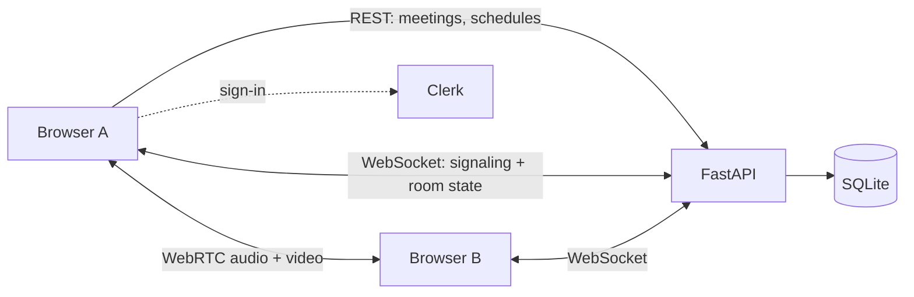

# Meetly

**Video meetings with a personality.** Meetly is a full-stack web app for starting, scheduling and joining browser-based video meetings, wrapped in a minimal black-and-white design with hand-drawn people illustrations.

[](https://github.com/prnvvv/Meetly/actions/workflows/ci.yml)


---

## Contents

- [Features](#features)
- [How it works](#how-it-works)
- [Tech stack](#tech-stack)
- [Getting started](#getting-started)
- [Project structure](#project-structure)
- [API overview](#api-overview)
- [Testing and CI](#testing-and-ci)
- [Design](#design)
- [Limitations](#limitations)
- [Roadmap](#roadmap)

---

## Features

**Meetings**
- **Instant meetings** with a server-generated nine-digit ID, a shareable invite link and an optional password (bcrypt-hashed, checked on both REST and WebSocket join).
- **Join** by meeting ID or by pasting an invite link.
- **Schedule** meetings, view them on a month calendar and edit them until they start.
- **Live rooms** with grid, speaker and auto layouts, pin-to-stage, active-speaker highlighting, reactions, fullscreen and keyboard shortcuts (`M` mute, `V` video, `P` participants, `F` fullscreen).
- **Host controls**: mute a participant, mute everyone, remove someone, end the meeting for all.

**New Meeting setup** (`/new-meeting`)
- Optional meeting name and password, both empty by default.
- A 16:9 camera preview with a *Camera On / Off* badge, plus camera, microphone and speaker pickers. Camera and microphone start **off**; nothing asks for permission until you switch them on.
- **Copy Invite Link** creates the meeting once and copies its link; **Start Meeting** enters the room.
- An *Invite People* picker and meeting settings (waiting room, lock, mute on entry, unmuting, screen sharing, chat, host controls, recording). These are **saved per meeting but not enforced yet**, and the friends are mock data; see [Limitations](#limitations).

**Dashboard**
- One screen that fits the viewport on desktop: greeting, quick actions, a month calendar with a day dialog, and compact *Upcoming* / *Recent* lists.

**Account**
- Email/password sign-in and sign-up through [Clerk](https://clerk.com), with every non-public route protected.

---

## How it works

The backend handles **state and signaling only**. Audio and video travel directly between browsers.



1. **REST** creates, validates, schedules and ends meetings.
2. A per-meeting **WebSocket** (`/ws/meetings/{id}`) carries joins and leaves, SDP/ICE signaling, media state, reactions and host actions. Every message is validated with Pydantic, and host actions are checked against server-side state.
3. **WebRTC** connects participants in a peer-to-peer mesh, using a public STUN server for NAT traversal.

On the client, one hook (`useMeeting`) owns the room lifecycle: join validation, media, socket, peer connections and host actions.

---

## Tech stack

| Area | Technology |
|---|---|
| Frontend | Next.js 16 (App Router), React 19, TypeScript (strict) |
| Styling | Plain CSS on shared design tokens; Tailwind CSS 4 and GSAP on the landing page |
| Auth | Clerk (`@clerk/nextjs`) |
| Realtime and media | Native WebSocket, WebRTC, Web Audio API |
| Backend | FastAPI, Pydantic 2, SQLAlchemy 2, Uvicorn, bcrypt |
| Database | SQLite by default (any SQLAlchemy URL via `DATABASE_URL`) |
| Tests | Vitest + Testing Library (frontend), pytest (backend) |
| CI | GitHub Actions, Dependabot |

---

## Getting started

**Prerequisites:** Node.js 22, Python 3.13 (3.10+ works), and a free [Clerk](https://dashboard.clerk.com) application for the sign-in keys.

### 1. Backend

```bash
cd backend
python -m venv .venv
source .venv/bin/activate        # Windows: .venv\Scripts\activate
pip install -r requirements.txt
uvicorn app.main:app --reload --port 8000
```

The API is at <http://localhost:8000> with interactive docs at `/docs`. The schema and a demo host user are created on startup; no database setup is needed.

### 2. Frontend

```bash
cd frontend
cp .env.local.example .env.local   # then add your Clerk keys
npm install
npm run dev
```

Open <http://localhost:3000>, sign up, and start a meeting. Open the invite link in a second browser or profile to try a two-person call.

> `scripts/run-all.sh` starts both services together (Git Bash on Windows, any shell on macOS/Linux).

### Environment variables

Nothing is loaded from `.env` automatically in the backend, so export values in your shell if you need to change the defaults.

| Variable | Where | Purpose | Default |
|---|---|---|---|
| `NEXT_PUBLIC_CLERK_PUBLISHABLE_KEY`, `CLERK_SECRET_KEY` | frontend | Clerk keys (**required**, never commit them) | — |
| `NEXT_PUBLIC_API_URL` | frontend | Backend origin for REST and WebSocket | `http://localhost:8000` |
| `NEXT_PUBLIC_STUN_SERVER` | frontend | WebRTC STUN server | Google public STUN |
| `DATABASE_URL` | backend | SQLAlchemy database URL | `sqlite:///./data/zoom_clone.db` |
| `FRONTEND_URL` | backend | Allowed CORS origins, also used to build invite links | `http://localhost:3000` |
| `STUN_SERVER` | backend | STUN server advertised to clients | Google public STUN |

Templates: `frontend/.env.local.example`, `backend/.env.example`.

---

## Project structure

```text
.
├── backend/
│   ├── app/
│   │   ├── routers/        # thin REST handlers: users, meetings, schedules, participants
│   │   ├── services/       # business rules: meetings, schedules, participants, history
│   │   ├── websocket/      # room endpoint, connection manager, gateway adapter
│   │   ├── models/ schemas/ database/ utils/ config/
│   │   └── main.py         # app factory, CORS, startup
│   └── tests/              # pytest: REST, services, WebSocket
├── frontend/
│   ├── public/images/      # illustrations and empty-state graphics
│   └── src/
│       ├── app/            # routes: /, /dashboard, /new-meeting, /join, /schedule,
│       │                   #   /meetings, /meetings/[id], /settings
│       ├── components/     # landing, dashboard, meeting, layout, common, icons
│       ├── hooks/          # useMeeting, useWebRTC, useMediaDevices, useCalendarMeetings, ...
│       ├── lib/ services/  # API client, WebSocket, WebRTC helpers, calendar utils
│       ├── styles/         # surface stylesheets on shared tokens
│       └── types/          # TypeScript mirrors of the backend schemas
├── docs/design-system.md   # tokens, components and the rationale behind them
├── scripts/                # run-all / run-backend / run-frontend, e2e_probe.py
└── .github/workflows/      # CI
```

---

## API overview

Full interactive documentation is served at `/docs`. `{meeting_id}` is the public nine-digit ID.

| Method | Endpoint | Purpose |
|---|---|---|
| `POST` | `/api/meetings` | Create an instant meeting |
| `GET` | `/api/meetings/{meeting_id}` | Meeting details |
| `POST` | `/api/meetings/{meeting_id}/join` | Validate joinability and password |
| `DELETE` | `/api/meetings/{meeting_id}` | End an active meeting or cancel a scheduled one |
| `GET` `POST` | `/api/meetings/{meeting_id}/participants` | List or add participants |
| `POST` | `/api/schedules` | Schedule a meeting |
| `GET` | `/api/schedules/upcoming`, `/recent` | Dashboard lists |
| `GET` | `/api/schedules/range?start=&end=` | Meetings in a date range (calendar) |
| `PATCH` | `/api/schedules/{meeting_id}` | Edit a meeting that has not started |
| `WS` | `/ws/meetings/{meeting_id}` | Signaling and room state |

WebSocket messages: `join`, `leave`, `offer`, `answer`, `ice_candidate`, `meeting_state`, `media_state`, `screen_share`, `mute_participant`, `remove_participant`, `end_meeting`, `reaction`, `ping`. Errors carry a stable `code` and a safe `message`.

---

## Testing and CI

```bash
cd backend  && pytest                 # REST, services and WebSocket tests
cd frontend && npm test               # 263 tests (Vitest, jsdom)
cd frontend && npm run typecheck && npm run lint && npm run build
python scripts/e2e_probe.py http://localhost:8000   # end-to-end probe against a running backend
```

GitHub Actions runs two jobs on every push and pull request to `main`: backend (`compileall` + `pytest`) and frontend (`typecheck`, `lint`, `test`, `build`). All of them must pass.

---

## Design

Meetly's look comes from its landing page: a white page with a faint dotted grid, pure black for actions, hairline grey borders, rounded cards and heavy, tightly tracked type. A hand-drawn, black-and-white illustration style is the visual signature, and new artwork should follow it. The dashboard and the New Meeting page size themselves from the viewport so they fit without scrolling on desktop, and stack on smaller screens. Tokens and rules are documented in [`docs/design-system.md`](docs/design-system.md).

---

## Limitations

Meetly is a well-structured application, not yet a hardened production service.

- **No server-side enforcement of New Meeting settings.** The meeting API accepts only a title and password. Waiting room, lock, mute on entry and the other preferences are stored in the browser for the meeting and tagged *Soon* in the UI.
- **Invite People is mock data.** No invitations are sent.
- **The REST API is not authenticated.** Clerk protects the web app, but the backend does not tie requests to a user, so signed-in users share the same meetings, and the first person to join a room becomes its host.
- **Peer-to-peer mesh with STUN only.** It suits small meetings; strict NATs need a TURN server, and large rooms need an SFU.
- **No screen-sharing control, chat, recording or captions yet.** The backend already relays screen-share state.
- **SQLite** is the tested database, with no migration tool wired up.

---

## Roadmap

- Enforce meeting settings server-side, and add real friends and invitations.
- Link Clerk identities to participants and protect the REST API per user.
- Screen sharing, in-meeting chat, recording and captions.
- TURN support, and an SFU for larger rooms.
- PostgreSQL with migrations, and browser-level end-to-end tests.

---

## License

No license file is published yet, so all rights are reserved by the repository owner.
